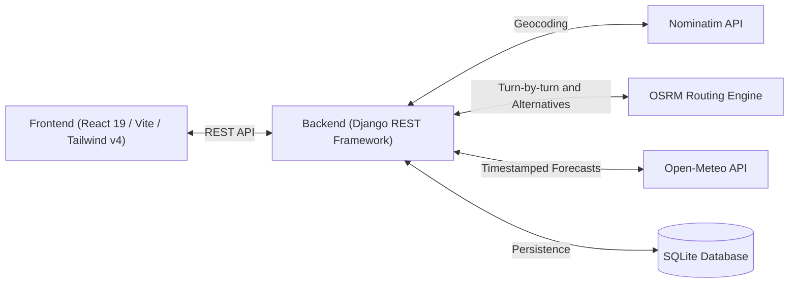

# Weather-Aware Truck Routing

A full-stack, weather-integrated dispatch and routing intelligence platform designed for commercial freight operations. The system computes multiple driving routes between arbitrary origin and destination points, calculates dynamic checkpoints along the path, enriches each checkpoint with timestamped atmospheric weather forecasts, and applies freight-specific risk modeling to recommend the safest route.

---

## Architecture Overview

The system is architected as a decoupled, domain-first monorepo consisting of a Python/Django REST backend and a modern React 19 / Vite frontend.



### System Workflow

1. **Geocoding & Route Calculation**: User inputs origin, destination, departure time, and vehicle load weight. The backend geocodes points using OpenStreetMap Nominatim and queries OSRM for alternative highway routes.
2. **Dynamic Checkpoint Sampling**: Routes are interpolated into discrete checkpoints at configurable intervals (10, 25, or 50 miles), computing estimated arrival times for each segment.
3. **Atmospheric Weather Enrichment**: Each checkpoint arrival time is matched against Open-Meteo hourly weather models (temperature, precipitation, wind speed, gusts, visibility, snowfall, and weather codes).
4. **Freight Risk Assessment**: An analytical risk engine evaluates wind shear (adjusted for trailer weight), freezing surface temperatures, precipitation rate, and road visibility, categorizing risk from `Low` to `No Travel`.
5. **Interactive Visualization**: The frontend renders Leaflet map routes color-coded by weather hazard, an interactive 48-hour forecast timeline slider, and route comparison cards.

---

## Directory Structure

```
weather-aware-truck-routing/
├── backend/                  # Django REST Framework API & risk engine
│   ├── config/               # Django project configuration & settings
│   ├── routes/               # Routes app (models, views, serializers, services)
│   │   ├── services/         # Routing, weather, and risk calculation services
│   │   ├── models.py         # RouteQuery, Route, and Checkpoint models
│   │   ├── views.py          # REST API endpoints
│   │   └── urls.py           # API URL routing
│   ├── manage.py             # Django management entry point
│   ├── requirements.txt      # Python dependencies
│   └── README.md             # Backend service documentation
├── frontend/                 # React 19 + TypeScript + Vite application
│   ├── src/
│   │   ├── app.tsx           # TanStack Router configuration
│   │   ├── components/ui/    # Base UI / shadcn component primitives
│   │   └── domains/          # UCFAS Domain-First modules
│   │       └── truck-routes/ # Routes domain (components, hooks, services, types, views)
│   ├── package.json          # Frontend dependencies & scripts
│   ├── vite.config.ts        # Vite configuration with Tailwind v4
│   └── README.md             # Frontend application documentation
├── docs/                     # Architectural documentation
└── README.md                 # Root repository overview
```

---

## Prerequisites

- **Python**: 3.10+
- **Node.js / Bun**: Bun 1.1+ (or Node.js 20+)
- **Operating System**: macOS, Linux, or Windows (PowerShell / WSL)

---

## Quickstart

### 1. Clone Repository

```bash
git clone https://github.com/your-username/weather-aware-truck-routing.git
cd weather-aware-truck-routing
```

### 2. Backend Setup

```bash
cd backend

# Create virtual environment
python -m venv .venv

# Activate virtual environment
# Windows:
.venv\Scripts\activate
# Linux/macOS:
source .venv/bin/activate

# Install dependencies
pip install -r requirements.txt

# Run migrations
python manage.py migrate

# Start backend development server (runs on http://localhost:8000)
python manage.py runserver
```

### 3. Frontend Setup

In a separate terminal:

```bash
cd frontend

# Install dependencies
bun install

# Start frontend development server (runs on http://localhost:5173)
bun run dev
```

---

## Environment Variables

### Backend Configuration (`backend/.env`)

| Variable | Default | Purpose |
|---|---|---|
| `SECRET_KEY` | `django-insecure-spotter-dev-key` | Django cryptographic secret |
| `DEBUG` | `True` | Debug mode toggle |
| `ALLOWED_HOSTS` | `localhost,127.0.0.1,*` | Allowed host headers |
| `NOMINATIM_USER_AGENT` | `SpotterRouteApp/1.0` | Custom User-Agent header for Nominatim OSM API |

### Frontend Configuration (`frontend/.env`)

| Variable | Default | Purpose |
|---|---|---|
| `VITE_API_URL` | `http://localhost:8000/api` | Base URL for Django REST API endpoints |

---

## Quality Assurance & Verification

### Backend Verification

```bash
cd backend
python manage.py check
python manage.py test
```

### Frontend Verification

```bash
cd frontend
bun run check        # Ultracite (Biome) format & lint check
bun run lint         # Oxlint static analysis
bunx vitest run      # Unit test suite
bun run build        # TypeScript strict typecheck & Vite production build
```

---

## License

This project is licensed under the MIT License.
